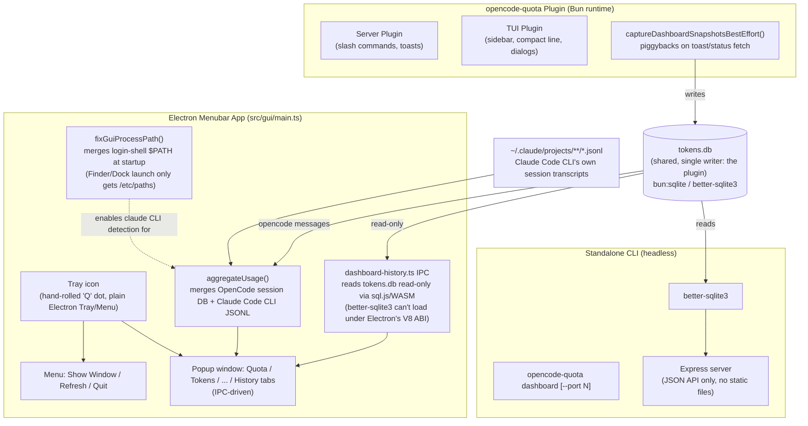

# OpenCode Quota Dashboard - Technical Specification

**Project**: `opencode-quota`  
**Feature**: Rich visual dashboard for quota & cost analytics  
**Priority**: High  
**Estimated Effort**: 2-3 weeks  
**Date**: 2026-07-03  
**Status**: **Pivoted (2026-07-06)** — the browser-based web UI described in this spec was built, then **removed the same day** and replaced with a native History tab in the menubar app, which was then extended with burn-rate/projection analytics and multi-source (OpenCode/Claude Code CLI/Copilot/DeepSeek) ingestion. See [Post-MVP Pivot](#post-mvp-pivot-2026-07-06-web-ui-removed-menubar-only), [History Tab Analytics](#history-tab-analytics-2026-07-06), [Claude Code CLI Integration & the GUI PATH Bug](#claude-code-cli-integration--the-gui-path-bug-2026-07-06), and [Implementation Status](#implementation-status).

---

## Executive Summary

Enhance opencode-quota from CLI/TUI-only to include a **web-based dashboard** for visualizing quota usage, cost trends, and weekly reset history. This addresses the gap vs. Claude History Viewer's analytics features while staying true to opencode-quota's local-first, open-source philosophy.

---

## Implementation Status

_Last verified: 2026-07-06, against `src/dashboard/`, `src/bin/dashboard.ts`, `src/gui/main.ts`, `src/gui/renderer/app.js`, `src/lib/anthropic.ts`, `src/lib/fix-gui-path.ts`, `src/lib/claude-code-cli-storage.ts`, and `tests/*`._

The dashboard shipped very close to this spec's schema and API shape, but diverged in a few real ways worth calling out before reading the rest of the doc:

| Area | Status | Notes |
|---|---|---|
| DB schema (`quota_snapshots`, `usage_history`, `weekly_resets`) | ✅ Done | Matches spec almost verbatim, plus a `schema_version` table |
| Migration mechanism | ⚠️ Diverged | Version-tracked via a `schema_version` row, not `PRAGMA user_version` |
| Backend API (3 routes + `DashboardApi`) | ✅ Done, +extra | All spec routes/methods exist, plus `/api/dashboard/providers`, `listProviders()`, `setUsageForDate()` |
| Config via env vars | ❌ Not built | `QUOTA_DASHBOARD_PORT` doesn't exist; port is hardcoded `3939`, overridable only via CLI `--port` flag |
| DB driver | ⚠️ Diverged | Three drivers, not one — `better-sqlite3` (CLI/tests), `bun:sqlite` (plugin runtime), `sql.js`/WASM (Electron GUI, read-only) |
| Frontend | ⚠️ Superseded | Browser UI (Chart.js/CDN) was built, then **deleted**; replaced by a native menubar **History** tab with hand-rolled bars/sparklines — see [History Tab Analytics](#history-tab-analytics-2026-07-06) |
| Background snapshot capture | ⚠️ Diverged | No `setInterval` polling job; capture piggybacks on the existing toast/status-fetch path as a side effect |
| `/quota_dashboard` auto-launch | ⚠️ Diverged | Command points at the menubar History tab as primary, headless `curl`-able API as secondary; it does **not** open a browser |
| Standalone launch | ✅ Done, +extra | `opencode-quota dashboard [--port N]` CLI subcommand, headless JSON API only (not in original spec) |
| Electron GUI embed | ⚠️ Superseded | GUI no longer runs any HTTP server; `src/gui/ipc/dashboard-history.ts` reads `DashboardApi` directly in-process via IPC instead |
| Claude Code CLI as a usage/quota source | ✅ Done, +extra | Not in original spec at all — see [Claude Code CLI Integration](#claude-code-cli-integration--the-gui-path-bug-2026-07-06) |
| GUI process PATH (Finder/Dock launch) | ✅ Fixed | `src/lib/fix-gui-path.ts` resolves the login shell's `PATH` at startup so Homebrew-installed CLIs (`claude`, etc.) are found — see below |
| Tests | ✅ Done | 6 test files covering snapshot/reset bridge, usage-history bridge, sql.js adapter, the slash command, Claude Code CLI storage ingestion, and the GUI PATH fix — no direct route/SQL test for `server.ts`/`api.ts` |

Details on each divergence are inline in the relevant sections below.

---

## Post-MVP Pivot (2026-07-06): Web UI Removed, Menubar-Only

Hours after the MVP+Phase2/3 build described in the table above shipped, the decision was made to **delete the browser-based web dashboard UI entirely** and consolidate quota history viewing into the menubar app. Rationale: the menubar already showed live quota; maintaining two UIs (web dashboard + menubar) reading the same SQLite database was duplicated surface area for no real benefit — the web dashboard wasn't more informative than the menubar could be made to be. The **headless JSON API was kept** (still useful for scripting/automation without launching Electron).

**What changed, concretely:**
- `src/dashboard/public/` (`index.html`, `styles.css`, `dashboard.js`, Chart.js-via-CDN) — **deleted**.
- `src/dashboard/server.ts` — no longer serves static files; **API routes only** (`/api/dashboard/summary`, `/quota-history/:provider`, `/usage-breakdown/:provider`, `/providers`).
- `src/gui/main.ts` — the in-process Express server it used to embed (`ensureDashboardServerStarted`, sql.js-backed) is **gone**, along with the tray's "Open Dashboard" menu item and the header's "📊 Dashboard" button. The GUI no longer runs any HTTP server at all.
- **New**: `src/gui/ipc/dashboard-history.ts` — the menubar reads `DashboardApi` directly in-process via IPC (still through the read-only sql.js adapter, for the same Electron/better-sqlite3 ABI reason as before), no HTTP hop.
- **New**: a 6th tab, **History**, in the menubar popup (`src/gui/renderer/app.js`) — burn-down sparkline, model cost bars, and reset history list, all hand-rolled with div/CSS bars (no Chart.js, no CSP changes needed — the renderer's CSP is `default-src 'self'`, which blocked the CDN Chart.js the old web dashboard used).
- `src/bin/dashboard.ts` / `opencode-quota dashboard` CLI — unchanged in behavior, just re-described as a headless API server (its help text and startup log no longer say "open your browser").
- `/quota_dashboard` slash command — now points at the menubar's History tab as the primary way to view history, with the headless `curl`-able API as the secondary/scripting option.
- `scripts/copy-data.mjs` — the now-deleted `public/*` copy entries removed (would otherwise fail the build).

This means the [Frontend UI](#frontend-ui) and [Electron GUI embed](#database-drivers-as-built) sections below describe a UI that **no longer exists** — kept for historical record of what was built and why the schema/API shape looks the way it does, not as current-state documentation.

---

## History Tab Analytics (2026-07-06)

Once the web dashboard was gone, the first version of the History tab (provider quota-history line + model cost bars + reset table, ported near-verbatim from the deleted web UI) was judged "not too useful — not very different from the Tokens tab, which already has cost." Two follow-up rounds of feature work addressed that, both implemented in `src/gui/renderer/app.js`:

**1. Source/model regrouping.** Quota history used to group only by canonical provider (`anthropic`, `openai`, ...). `renderModelSourceBreakdown()` instead groups the live `aggregateUsage()` result (`usage.aggregate.bySourceModel`, from `api.tokens.query`) by **source** — `opencode`, `claude-code-cli`, `github-copilot`, etc., reusing the Tokens tab's existing `normalizeSourceName()`/`sourceSortKey()` helpers so the two tabs stay visually consistent — with models listed as a subset underneath (e.g. `opencode/glm-5.2`), plus an `All` option that concatenates every source into one combined breakdown. This is a genuinely different axis than `usage_history`'s DB schema supports (that table only tracks canonical provider), so this breakdown is computed live rather than DB-backed.

**2. New analytics, not present in the Tokens tab:**
- **Burn-rate / pace / projection** (`computeBurnStats()`, rendered per quota-window-kind via `renderBurnCard()`) — for each active 5-hour and weekly window, compares elapsed-time-fraction against actual-%-used to produce a pace delta (e.g. "29pp ahead of steady pace"), plus a projected "runs out at HH:MM" or "safe until reset" verdict.
- **Weekly reset utilization** (enhanced `renderResetHistoryList()`) — adds a "N of M windows fully capped (≥99% used)" rollup line plus a per-row "used X% · left Y% unused" readout, surfacing how often a plan's quota is actually being maxed out.
- **"What's burning your quota"** (`renderBurningSessionsCard()`) — ranks recent sessions by a weighted score (`input + output + cache_write + cache_read*0.1`) and shows each session's share of local burn, adapted from the reference "Claude Assist" extension's session-ranking feature.

Sorted rendering order in `renderHistoryInto()`: provider/range selectors → burn cards (5h before weekly) → burning-sessions card → source/model breakdown card → reset-history card.

Deliberately **not** built (flagged as backlog, not requested): peak-utilization-per-window / throttle heatmap (needs denser snapshot sampling than the current opportunistic capture provides — a tradeoff not yet resolved) and session-duration-vs-burn scatter.

Charts are hand-rolled div/CSS bars and sparklines (`.sparkline`/`.sparkline-bar` in `src/gui/renderer/styles/app.css`), not Chart.js — chosen deliberately over reintroducing a charting library, since the renderer's `default-src 'self'` CSP would block a CDN load anyway and the data is simple enough not to need one.

---

## Claude Code CLI Integration & the GUI PATH Bug (2026-07-06)

The product direction expanded beyond opencode's own session data: opencode-quota's menubar/dashboard should surface **Claude Code CLI's own local usage** (its own JSONL session transcripts, independent of whether the user is also driving Claude through OpenCode), not just OpenCode's view of Anthropic quota. This was tackled in two parts, per explicit user sequencing ("(A) first then (B)", Claude Code only for now — no premature generalization to other CLIs like Copilot's or DeepSeek's own local stores):

**(A) Stop hiding Claude Code on re-auth / stale state.** `src/lib/anthropic.ts`:
- `hasAnthropicCredentialsConfigured()` now reflects `diagnostics.installed` only, instead of also requiring `authStatus === "authenticated"` — an expired/re-auth-needed CLI still shows up (with an error), rather than silently disappearing from the quota list.
- `queryAnthropicQuota()` surfaces **any** `diagnostics.message` as a user-visible error, not just when nominally authenticated.
- A `bypassCache` flag was threaded end-to-end: `QuotaProviderContext.config.bypassCache` (`src/lib/entries.ts`) → `buildMinimalProviderContext`/`fetchAllQuota` (`src/gui/ipc/quota.ts`) → `anthropicProvider.isAvailable`/`fetch` (`src/providers/anthropic.ts`) → `hasAnthropicCredentialsConfigured`/`queryAnthropicQuota` (`src/lib/anthropic.ts`), which skip Anthropic's own internal 5-second (`ANTHROPIC_DIAGNOSTICS_TTL_MS`) diagnostics cache on an explicit user-triggered refresh. Before this, running `claude auth login` and clicking refresh in the app could still show stale/missing Claude Code state until the next app relaunch, because the generic outer per-provider cache (`quota-state.ts`) and Anthropic's own inner cache weren't connected.

**(B) Ingest Claude Code CLI's own usage.** New `src/lib/claude-code-cli-storage.ts` reads `~/.claude/projects/**/*.jsonl` directly (filtering synthetic zero-token entries — `model: "<synthetic>"`, `isApiErrorMessage: true`) and maps entries into the same `OpenCodeMessage` shape the rest of the pipeline already uses. `aggregateUsage()` (`src/lib/quota-stats.ts`) merges this alongside OpenCode's own session DB (`iterAssistantMessages()` + `iterClaudeCodeCliMessages()` via `Promise.all`) in its global, non-session-scoped branch — so the Tokens tab and the History tab's source/model breakdown both now show Claude Code CLI usage and models even when the user never touched OpenCode for that session.

**The real root cause of "Dashboard still doesn't show Claude Code" (found after (A) and (B) both shipped and tested clean via Terminal-run scripts):** macOS apps launched via Finder/Dock/Spotlight — as the packaged Electron app always is — only inherit the OS default `PATH` (`/etc/paths`: `/usr/local/bin:/usr/bin:/bin:/usr/sbin:/sbin`), **not** the user's shell-profile `PATH` (`.zshrc`/`.zprofile` exports like Homebrew's `/opt/homebrew/bin` on Apple Silicon). `claude` lives at `/opt/homebrew/bin/claude` on this machine (confirmed via `which claude`; confirmed absent from `/etc/paths` via `grep -q opt/homebrew /etc/paths`, no match). So `execFile("claude", ...)` genuinely failed inside the running app — no caching or gating logic could have fixed this, since every test proving (A)/(B) worked was run from this Terminal-backed tool, which inherits full shell `PATH`.

**Fix**: new `src/lib/fix-gui-path.ts` (`resolveLoginShellPath()`, `mergePathEnv()`, `fixGuiProcessPath()`) spawns `$SHELL -ilc 'echo -n "$PATH"'` once (2s timeout, best-effort, never throws) and merges the result into `process.env.PATH`. Wired as the very first line inside `app.whenReady().then(async () => {...})` in `src/gui/main.ts`, before any provider probing happens — this benefits every CLI-shelling provider, not just Anthropic/Claude Code. Verified via a minimal-PATH simulation (`claude --version` fails before the fix, succeeds after) and via `tests/lib.fix-gui-path.test.ts` (10 tests).

---

## Current State

### What Works Today
✅ **22+ quota providers** (Anthropic, OpenAI, DeepSeek, OpenRouter, etc.)  
✅ **Slash commands** (`/quota`, `/quota_status`, `/quota_dashboard`) with text output  
✅ **TUI plugin** with compact status line + local dialogs  
✅ **Status bar indicator** in server plugin (popup toasts)  
✅ **Token tracking** with better-sqlite3 (session DB), merged with Claude Code CLI's own local JSONL usage  
✅ **Pricing data** from models.dev (auto-refresh)  
✅ **Menubar History tab** — per-window burn-rate/pace/projection, weekly reset utilization, "what's burning your quota" session ranking, source/model breakdown (hand-rolled bars, no web UI/Chart.js)  
✅ **Historical quota tracking** — snapshots captured opportunistically off the toast/status-fetch path  
✅ **Weekly reset history** — detected and recorded via `detectAndRecordWeeklyResets()`  
✅ **Cost trend analysis** — per-model cost breakdown over selectable time ranges (1d/7d/30d)  
✅ **Claude Code CLI recognized permanently** — surfaces on re-auth/expired state instead of disappearing, refreshes immediately on manual refresh (`bypassCache`), and is detectable from the packaged Finder/Dock-launched app (`fix-gui-path.ts` PATH fix)  

### What's Still Missing
❌ **Configurable port via env var** (`QUOTA_DASHBOARD_PORT` was planned, never implemented — CLI `--port` flag only)  
❌ **True background polling job** (capture is piggybacked on existing fetches, not a timer)  
❌ **Auto-launch browser from `/quota_dashboard`** (points at the menubar History tab / headless API instead — there is no browser UI left to launch)  
❌ **Peak-utilization-per-window / throttle heatmap** (needs denser snapshot sampling than today's opportunistic capture; backlog, not yet started)  
❌ **Session-duration-vs-burn scatter** (backlog, not yet started)  
❌ **Export to PDF/PNG, alerts, cost prediction** (all still "Nice-to-Have (Future)")  
❌ **Other sources beyond Claude Code CLI** (DeepSeek/Copilot own local usage stores, etc. — deliberately deferred; Claude Code was the only CLI-ingestion target requested so far)  

---

## Proposed Solution

### Architecture

```
┌─────────────────────────────────────────────────┐
│ opencode-quota Plugin (Node.js)                 │
│  ├─ Server Plugin (slash commands, toasts)      │
│  ├─ TUI Plugin (sidebar, compact line, dialogs) │
│  └─ Dashboard Module (NEW)                      │
│       ├─ HTTP Server (Express)                  │
│       ├─ SQLite DB (quota history)              │
│       ├─ Background Jobs (snapshot capture)     │
│       └─ Static Web UI (HTML/CSS/JS)            │
└─────────────────────────────────────────────────┘
           │
           │ localhost:3939 (configurable)
           ▼
┌─────────────────────────────────────────────────┐
│ Web Browser                                     │
│  ├─ Dashboard.html (main view)                  │
│  ├─ Chart.js (burn-down, model breakdown)       │
│  └─ Fetch API (poll /api/dashboard/*)           │
└─────────────────────────────────────────────────┘
```

**Key Design Decisions:**
1. **Embedded HTTP server** - Lives inside opencode-quota plugin process
2. **SQLite for time-series** - Store quota snapshots every 5 minutes
3. **Local-only** - No external services, no cloud sync (optional later)
4. **Auto-launch on `/quota_dashboard`** - Opens browser to dashboard
5. **Reuse existing infra** - Same SQLite engine, same pricing data, same quota providers

**As-built deviations (current, post-pivot):**
- There is no web browser surface anymore. Quota history/analytics are reachable **two ways**: a headless standalone CLI subcommand (`opencode-quota dashboard`, JSON API only, using `better-sqlite3`) and the Electron menubar's native **History** tab, which reads `DashboardApi` **directly in-process via IPC** (`src/gui/ipc/dashboard-history.ts`) — no HTTP hop, no Express server in the GUI at all anymore.
- Snapshot capture is **not** a timer. `src/plugin.ts`'s `captureDashboardSnapshotsBestEffort()` runs as a side effect whenever the existing toast/status-fetch path already pulls quota data, avoiding an extra polling loop.
- `/quota_dashboard` does **not** auto-launch a browser; it points the user at the menubar's History tab as primary, with the headless `curl`-able API as the scripting-friendly secondary option.
- Three DB drivers exist behind a shared `DatabaseLike` interface (`better-sqlite3`, `bun:sqlite`, `sql.js`) instead of one — see [Database Drivers](#database-drivers-as-built) below.
- A surface not in the original plan at all: an Electron menubar/tray app (`src/gui/main.ts`, launched via `opencode-quota gui`). It reads the DB read-only via `sql.js` directly in-process (no embedded server) and is now the **only** UI — the web dashboard it originally embedded was deleted the same day it shipped (see [Post-MVP Pivot](#post-mvp-pivot-2026-07-06-web-ui-removed-menubar-only)).
- The menubar's provider probing (including Claude Code CLI detection) now runs against a login-shell-resolved `PATH`, fixed at startup via `fixGuiProcessPath()` — see [Claude Code CLI Integration & the GUI PATH Bug](#claude-code-cli-integration--the-gui-path-bug-2026-07-06).

### Architecture — As Built (menubar-only, post-pivot)



The menubar app is optional and independent — it's launched separately (`opencode-quota gui`, spawning `dist/gui/main.js`), not started by the plugin or by the standalone dashboard CLI. It is read-only against `tokens.db`; the plugin process remains the sole writer regardless of which surfaces are running. `aggregateUsage()` additionally reads Claude Code CLI's own JSONL transcripts directly off disk — a source the plugin/DB never writes to.

---

## Database Schema

### New Tables (add to existing `opencode-quota/data/tokens.db`)

```sql
-- Quota snapshots (captured every 5 minutes)
CREATE TABLE IF NOT EXISTS quota_snapshots (
  id INTEGER PRIMARY KEY AUTOINCREMENT,
  provider TEXT NOT NULL,           -- 'anthropic', 'openai', 'deepseek', etc.
  captured_at INTEGER NOT NULL,     -- Unix timestamp (ms)
  quota_data TEXT NOT NULL,         -- JSON blob from provider API
  UNIQUE(provider, captured_at)
);

CREATE INDEX idx_snapshots_provider_time ON quota_snapshots(provider, captured_at);

-- Usage aggregated by day and model
CREATE TABLE IF NOT EXISTS usage_history (
  id INTEGER PRIMARY KEY AUTOINCREMENT,
  provider TEXT NOT NULL,
  date TEXT NOT NULL,               -- YYYY-MM-DD
  model TEXT,                       -- 'claude-3-5-sonnet-20241022', 'gpt-4o', etc.
  tokens_input INTEGER DEFAULT 0,
  tokens_output INTEGER DEFAULT 0,
  tokens_cache INTEGER DEFAULT 0,   -- Cache read tokens (Claude only)
  cost_usd REAL DEFAULT 0.0,
  request_count INTEGER DEFAULT 0,
  UNIQUE(provider, date, model)
);

CREATE INDEX idx_usage_provider_date ON usage_history(provider, date);

-- Weekly reset history (when quota windows reset)
CREATE TABLE IF NOT EXISTS weekly_resets (
  id INTEGER PRIMARY KEY AUTOINCREMENT,
  provider TEXT NOT NULL,
  reset_at INTEGER NOT NULL,        -- Unix timestamp (ms)
  quota_used REAL,                  -- % used at reset time
  quota_remaining REAL,             -- % remaining
  quota_limit REAL,                 -- Absolute limit (credits, requests, etc.)
  reset_type TEXT                   -- '5hour', '7day', 'monthly'
);

CREATE INDEX idx_resets_provider_time ON weekly_resets(provider, reset_at);
```

### Migration Strategy — As Built

The actual implementation (`src/dashboard/db-migrate.ts`) does **not** use `PRAGMA user_version` as originally planned. Instead it adds a fourth table, `schema_version`, and tracks the applied version as a row in that table:

```typescript
// opencode-quota/src/dashboard/db-migrate.ts (actual)
export function migrateSchema(db: DatabaseLike) {
  const version = getSchemaVersion(db); // SELECT version FROM schema_version LIMIT 1
  if (version < 1) {
    db.exec(SCHEMA_SQL); // applies schema.sql verbatim (all 4 CREATE TABLE IF NOT EXISTS)
    setSchemaVersion(db, 1);
  }
  // No version-2 migration exists yet — single-step only, same as originally planned.
}
```

The DDL itself lives in `src/dashboard/schema.sql` and matches the table/column names in this spec exactly.

---

## Backend API

### HTTP Server

**Port**: `3939` (as built: hardcoded default, overridable only via the CLI's `--port` flag — the planned `QUOTA_DASHBOARD_PORT` env var was never implemented; grep confirms no reference to it anywhere in the codebase)  
**Framework**: Express.js (real dependency, `express@^4.18.2` in `package.json`)  
**CORS**: Disabled (localhost-only)  
**Auth**: None (local-only access)  

**As built, `server.ts` also exposes a 4th route not in the original plan:**
```
GET /api/dashboard/providers   → listProviders() — populates the frontend's provider <select> dynamically
```
And `DashboardApi` (`api.ts`) has two extra methods beyond the ones documented below:
- `setUsageForDate(...)` — replace-not-increment write used by the usage-history sync bridge (`usage-history-bridge.ts`), so re-syncing a day doesn't double-count.
- `listProviders()` — backs the `/api/dashboard/providers` route.

**Post-pivot (2026-07-06): no longer serves static files.** The `app.use(express.static(...))` line below and the `public/` directory it pointed at were removed — `server.ts` is JSON-API-only now, consumed by the standalone CLI and by `curl`, not by a browser.

```typescript
// opencode-quota/src/dashboard/server.ts
import express from 'express';
import { DashboardApi } from './api.js';

export function startDashboardServer(port: number, dbPath: string): Server {
  const app = express();
  const dashboardApi = new DashboardApi(dbPath);

  // API routes
  app.get('/api/dashboard/summary', (req, res) => {
    const providers = req.query.providers?.toString().split(',') || ['anthropic', 'openai'];
    const days = parseInt(req.query.days?.toString() || '7', 10);
    
    const summary = {
      providers: providers.map(provider => ({
        provider,
        currentQuota: dashboardApi.getCurrentQuota(provider),
        quotaHistory: dashboardApi.getQuotaHistory(provider, days),
        modelBreakdown: dashboardApi.getModelBreakdown(provider, days),
        weeklyResets: dashboardApi.getWeeklyResets(provider, 4)
      })),
      timestamp: Date.now()
    };
    
    res.json(summary);
  });
  
  app.get('/api/dashboard/quota-history/:provider', (req, res) => {
    const { provider } = req.params;
    const days = parseInt(req.query.days?.toString() || '7', 10);
    const history = dashboardApi.getQuotaHistory(provider, days);
    res.json({ provider, history });
  });
  
  app.get('/api/dashboard/usage-breakdown/:provider', (req, res) => {
    const { provider } = req.params;
    const days = parseInt(req.query.days?.toString() || '7', 10);
    const breakdown = dashboardApi.getModelBreakdown(provider, days);
    res.json({ provider, breakdown });
  });
  
  const server = app.listen(port, '127.0.0.1', () => {
    console.log(`📊 Quota Dashboard running at http://localhost:${port}`);
  });
  
  return server;
}
```

### API Implementation

```typescript
// opencode-quota/src/dashboard/api.ts
import Database from 'better-sqlite3';

interface QuotaSnapshot {
  timestamp: number;
  provider: string;
  limits: QuotaLimit[];
  percentUsed: number;
  percentRemaining: number;
}

interface QuotaLimit {
  kind: string;               // 'session', 'weekly_all', 'monthly'
  group: string;              // 'session', 'weekly', 'monthly'
  percent: number;            // 0-100
  severity: string;           // 'normal', 'warning', 'critical'
  resets_at: string;          // ISO timestamp
  scope?: { model?: string }; // Optional model-specific limit
}

export class DashboardApi {
  private db: Database.Database;
  
  constructor(dbPath: string) {
    this.db = new Database(dbPath);
    migrateSchema(this.db);
  }
  
  // Capture current quota snapshot
  captureSnapshot(provider: string, quotaData: any) {
    const now = Date.now();
    this.db.prepare(`
      INSERT INTO quota_snapshots (provider, captured_at, quota_data)
      VALUES (?, ?, ?)
      ON CONFLICT(provider, captured_at) DO UPDATE SET quota_data = excluded.quota_data
    `).run(provider, now, JSON.stringify(quotaData));
  }
  
  // Get current quota (latest snapshot)
  getCurrentQuota(provider: string): any {
    const row = this.db.prepare(`
      SELECT quota_data
      FROM quota_snapshots
      WHERE provider = ?
      ORDER BY captured_at DESC
      LIMIT 1
    `).get(provider);
    
    return row ? JSON.parse(row.quota_data) : null;
  }
  
  // Get quota history for chart
  getQuotaHistory(provider: string, days: number = 7): QuotaSnapshot[] {
    const since = Date.now() - (days * 24 * 60 * 60 * 1000);
    
    const rows = this.db.prepare(`
      SELECT captured_at, quota_data
      FROM quota_snapshots
      WHERE provider = ? AND captured_at >= ?
      ORDER BY captured_at ASC
    `).all(provider, since);
    
    return rows.map(row => {
      const data = JSON.parse(row.quota_data);
      return {
        timestamp: row.captured_at,
        provider,
        limits: data.limits || [],
        percentUsed: 100 - (data.percentRemaining || 0),
        percentRemaining: data.percentRemaining || 0
      };
    });
  }
  
  // Record usage for a session
  recordUsage(provider: string, date: string, model: string, usage: {
    tokensInput: number;
    tokensOutput: number;
    tokensCache: number;
    costUsd: number;
    requestCount: number;
  }) {
    this.db.prepare(`
      INSERT INTO usage_history (provider, date, model, tokens_input, tokens_output, tokens_cache, cost_usd, request_count)
      VALUES (?, ?, ?, ?, ?, ?, ?, ?)
      ON CONFLICT(provider, date, model) DO UPDATE SET
        tokens_input = tokens_input + excluded.tokens_input,
        tokens_output = tokens_output + excluded.tokens_output,
        tokens_cache = tokens_cache + excluded.tokens_cache,
        cost_usd = cost_usd + excluded.cost_usd,
        request_count = request_count + excluded.request_count
    `).run(
      provider,
      date,
      model,
      usage.tokensInput,
      usage.tokensOutput,
      usage.tokensCache,
      usage.costUsd,
      usage.requestCount
    );
  }
  
  // Get per-model breakdown
  getModelBreakdown(provider: string, days: number = 7): ModelUsage[] {
    const since = new Date(Date.now() - (days * 24 * 60 * 60 * 1000)).toISOString().split('T')[0];
    
    const rows = this.db.prepare(`
      SELECT model,
             SUM(tokens_input) as tokens_input,
             SUM(tokens_output) as tokens_output,
             SUM(tokens_cache) as tokens_cache,
             SUM(cost_usd) as cost_usd,
             SUM(request_count) as request_count
      FROM usage_history
      WHERE provider = ? AND date >= ?
      GROUP BY model
      ORDER BY cost_usd DESC
    `).all(provider, since);
    
    return rows.map(row => ({
      model: row.model,
      tokensInput: row.tokens_input,
      tokensOutput: row.tokens_output,
      tokensCache: row.tokens_cache,
      costUsd: row.cost_usd,
      requestCount: row.request_count
    }));
  }
  
  // Get weekly reset history
  getWeeklyResets(provider: string, weeks: number = 4): WeeklyReset[] {
    const since = Date.now() - (weeks * 7 * 24 * 60 * 60 * 1000);
    
    return this.db.prepare(`
      SELECT reset_at, quota_used, quota_remaining, quota_limit, reset_type
      FROM weekly_resets
      WHERE provider = ? AND reset_at >= ?
      ORDER BY reset_at DESC
    `).all(provider, since);
  }
  
  // Record weekly reset
  recordWeeklyReset(provider: string, resetType: string, quotaData: {
    used: number;
    remaining: number;
    limit: number;
  }) {
    this.db.prepare(`
      INSERT INTO weekly_resets (provider, reset_at, quota_used, quota_remaining, quota_limit, reset_type)
      VALUES (?, ?, ?, ?, ?, ?)
    `).run(
      provider,
      Date.now(),
      quotaData.used,
      quotaData.remaining,
      quotaData.limit,
      resetType
    );
  }
}
```

---

## Database Drivers (As Built)

The spec originally anticipated a single `better-sqlite3` backend. The shipped implementation instead defines a shared `DatabaseLike` interface with **three** concrete adapters, because the dashboard is consumed from three different runtimes:

| Adapter | File | Used by | Why |
|---|---|---|---|
| `better-sqlite3` | (existing lib) | Standalone CLI (`bin/dashboard.ts`), tests | Fast native binding, fine in a plain Node process |
| `bun:sqlite` | `bun-sqlite-database.ts` | The actual opencode plugin runtime (Bun) | opencode's plugin host runs on Bun; `bun:sqlite` is built in, avoiding native-ABI rebuild issues that `better-sqlite3` has under Bun |
| `sql.js` (WASM) | `sqljs-database.ts` | Electron GUI process | `better-sqlite3` is a native addon compiled against Node's ABI and doesn't load under Electron's bundled V8 without a rebuild step; a real `npmRebuild: true` attempt against Electron 42 + better-sqlite3 12.10.0 didn't pan out, so the GUI instead uses a read-only sql.js adapter that re-opens the DB file whenever its mtime changes. It never persists writes back — the plugin process (via `bun:sqlite` or `better-sqlite3`) remains the sole writer. |

This is why `package.json` lists `express`, `sql.js` + `@types/sql.js`, and `better-sqlite3` as real dependencies, but no separate npm package for `bun:sqlite` (it ships inside the Bun runtime).

---

## Frontend UI (Historical — Deleted 2026-07-06)

The MVP shipped a browser-based dashboard closely matching the sketch below: a header with provider/time-range selectors, quota cards, a Chart.js burn-down line chart, a Chart.js model-cost bar chart, and a weekly-reset table, served as static files (`src/dashboard/public/index.html`, `styles.css`, `dashboard.js`) with Chart.js loaded from the jsdelivr CDN. It was deleted the same day it shipped — see [Post-MVP Pivot](#post-mvp-pivot-2026-07-06-web-ui-removed-menubar-only) for why — and replaced by the menubar's native History tab ([History Tab Analytics](#history-tab-analytics-2026-07-06)), which covers the same ground (quota cards, burn-down, model breakdown, reset history) plus burn-rate/pace/projection and source grouping that the web UI never had.

The full original HTML/CSS/JS sketch is preserved in git history (this file, pre-2026-07-06) rather than inline here, since it describes code that no longer exists in the repo.


---

## Integration with Existing Plugin (As Built)

The shipped integration diverges from the original plan in three ways (original code sketch preserved in git history, pre-2026-07-06, rather than inline here):

1. **No always-on server inside the plugin process.** The plugin process only captures snapshots/usage/resets as a side effect of its existing toast/status-fetch path (`captureDashboardSnapshotsBestEffort()` in `src/plugin.ts`). Serving data is done separately by either the standalone headless CLI (`opencode-quota dashboard`) or the Electron menubar reading `DashboardApi` directly in-process via IPC — not by the plugin itself, and not via any HTTP server in the GUI (that was removed in the [Post-MVP Pivot](#post-mvp-pivot-2026-07-06-web-ui-removed-menubar-only)).
2. **No `setInterval` polling loop.** Snapshot capture, weekly-reset detection (`detectAndRecordWeeklyResets()`), and usage-history sync (`syncTodayUsageHistory()`) all run inline whenever quota data is already being fetched for the toast — there's no dedicated timer duplicating that fetch.
3. **`/quota_dashboard` doesn't open a browser.** It's a slash command in `src/lib/quota-dialog-commands.ts` that points at the menubar's History tab as the primary way to view history, with the headless `curl`-able API as the scripting-friendly secondary option.

---

## Testing Strategy

### As Built

Six real test files exist under `tests/` (flat naming, no `__tests__` dir):
- `dashboard.quota-snapshot-bridge.test.ts` (203+ lines) — snapshot capture and weekly-reset detection logic, plus an `errorResult()`-based test for capturing an error snapshot when a provider has no entries but a fetch error.
- `dashboard.usage-history-bridge.test.ts` (125 lines) — today-sync and backfill against a mocked `aggregateUsage`.
- `dashboard.sqljs-database.test.ts` (87 lines) — the sql.js adapter reading data written by a separate better-sqlite3 writer, and its behavior when the DB file doesn't exist yet.
- `lib.quota-dialog-commands.quota-dashboard.test.ts` (119 lines) — the `/quota_dashboard` command: argument rejection, unreachable-DB message, no-snapshots message, listing providers with data, and now the menubar/`opencode-quota gui` pointer text.
- `lib.claude-code-cli-storage.test.ts` (NEW) — 7 tests against real tmpdir JSONL fixtures: parses assistant messages, filters synthetic zero-token entries, handles malformed/missing files.
- `lib.fix-gui-path.test.ts` (NEW) — 10 tests covering `resolveLoginShellPath` (win32 no-op, real PATH, banner-noise handling, shell failure, empty output), `mergePathEnv` (prepend/de-dupe/undefined-current), and `fixGuiProcessPath` (merges into a given env, leaves it untouched on failure). Required manually attaching `util.promisify.custom` to the `execFile` mock to match Node's real promisify behavior.
- `tests/lib.anthropic.test.ts` and `tests/providers.anthropic.test.ts` — updated/added cases for the re-auth-surfacing behavior and `bypassCache` forwarding end-to-end.
- `tests/quota-stats.test.ts` — added cases for the OpenCode + Claude Code CLI merge in `aggregateUsage()`.

**Gap:** no test exercises `server.ts`'s Express routes or `api.ts`'s SQL queries directly (the hypothetical `DashboardApi` unit tests sketched below were never written as such — coverage instead comes indirectly through the bridge and sql.js tests above). Worth adding if `api.ts`/`server.ts` change again. As of 2026-07-06: 129 test files, 1276 tests passing, typecheck clean.

A `DashboardApi` unit-test sketch (`tests/dashboard-api.test.ts`, direct `captureSnapshot`/`getQuotaHistory`/`recordUsage`/`getModelBreakdown` coverage against a tmpdir SQLite file) was planned but never written verbatim — coverage instead comes indirectly through the bridge and sql.js tests listed above. Still a real gap; worth adding if `api.ts`/`server.ts` change again. (Original sketch preserved in git history, pre-2026-07-06.)

### Integration Tests
- [x] Headless dashboard server (`opencode-quota dashboard`) starts and responds on `/api/dashboard/providers`, `/api/dashboard/summary`
- [ ] Menubar History tab renders against a real production `tokens.db` without errors (covered so far by direct backend/data verification via `tsx` scripts, not a visual Electron launch — see [Claude Code CLI Integration](#claude-code-cli-integration--the-gui-path-bug-2026-07-06) for why)
- [ ] Background snapshot capture piggybacks correctly on every toast/status fetch (no dedicated timer to test)

### Manual Testing Checklist
- [ ] Open the menubar's History tab and verify quota cards / burn cards show current status
- [ ] Verify per-window burn-rate/pace/projection cards (5h and weekly)
- [ ] Verify "what's burning your quota" session ranking
- [ ] Verify weekly reset utilization rollup and per-row used/left readout
- [ ] Verify source/model breakdown grouping, including the "All" concatenated option
- [ ] Verify Claude Code CLI appears in the Dashboard/Tokens tabs after `claude auth login`, without needing to relaunch the app
- [ ] Verify time range selector works (1d/7d/30d)

---

## Deployment & Rollout

### Phase 1: MVP (Week 1-2)
- [x] Database schema + migration (`schema_version`-based, not `PRAGMA user_version`)
- [x] Backend API (Express + SQLite, plus `better-sqlite3`/`bun:sqlite`/`sql.js` drivers)
- [x] Basic HTML/CSS/JS
- [x] `/quota_dashboard` slash command (status report + instructions, not auto-launch)

### Phase 2: Charts (Week 2-3)
- [x] Integrate Chart.js (via CDN)
- [x] Burn-down chart
- [x] Model breakdown chart
- [x] Weekly reset history table

### Phase 3: Polish (Week 3)
- [x] Auto-refresh (frontend polling, every 5 min)
- [x] Multi-provider support (dynamic provider picker via `/api/dashboard/providers`)
- [x] Time range selector (1d/7d/30d)
- [ ] Responsive design (mobile-friendly) — not verified

### Phase 4: Documentation (Week 3)
- [ ] Update README with dashboard screenshots
- [ ] Add configuration docs (port, DB path)
- [ ] GIF demo (like Claude History Viewer)
- [x] This spec updated to reflect as-built state (2026-07-06)

---

## Configuration

### As Built
None of the planned env vars were implemented. The only actual configuration knob is the CLI flag on the standalone dashboard subcommand:
```bash
opencode-quota dashboard --port 4000   # default port: 3939
```
DB path is not configurable — the dashboard reuses the same `tokens.db` path the rest of the plugin already uses. There is no snapshot-interval setting since capture isn't timer-driven (see [Integration](#integration-with-existing-plugin-as-built)).

### Originally Planned Environment Variables (not implemented)
```bash
QUOTA_DASHBOARD_PORT=3939          # HTTP server port (default: 3939)
QUOTA_DASHBOARD_DB=./data/tokens.db  # SQLite DB path (default: reuse existing)
QUOTA_SNAPSHOT_INTERVAL=300        # Snapshot capture interval in seconds (default: 300 = 5 min)
```

### Config File (Optional Future)
```json
// opencode-quota/quota-dashboard.json
{
  "port": 3939,
  "autoCapture": true,
  "captureIntervalSeconds": 300,
  "providers": ["anthropic", "openai", "deepseek"],
  "defaultTimeRangeDays": 7
}
```

---

## Security Considerations

1. **Local-only access** - Dashboard binds to `127.0.0.1` (localhost), not `0.0.0.0`
2. **No auth required** - Safe because local-only (no network exposure)
3. **HTTPS optional** - Not needed for localhost; could add self-signed cert if desired
4. **No sensitive data in frontend** - API keys never sent to dashboard (only quota percentages)
5. **SQLite permissions** - Ensure tokens.db has user-only read/write (`chmod 600`)

**Future enhancement:** Optional password protection via `QUOTA_DASHBOARD_PASSWORD` env var.

---

## Performance Targets

- Dashboard load time: <500ms
- Chart render time: <200ms
- Snapshot capture: <100ms per provider
- Database query time: <50ms (indexed queries)
- Memory footprint: <50MB for dashboard server

---

## Success Criteria

### Must-Have (MVP, superseded by the menubar History tab — see [History Tab Analytics](#history-tab-analytics-2026-07-06))
- [x] History reachable via the menubar's History tab, or the headless `opencode-quota dashboard` API for scripting (`/quota_dashboard` points at both rather than auto-launching a browser)
- [x] Quota cards show current status, per quota-window kind
- [x] Burn-down / burn-rate shows trend, with pace and projection (beyond the original "just a chart" ask)
- [x] Model breakdown shows top models, grouped by source
- [x] Weekly reset history visible, with utilization rollup
- [x] Auto-refresh on tab open / manual refresh (no 5-minute polling loop — there's no browser tab to poll in the background)

### Nice-to-Have (Future)
- [ ] Export dashboard to PDF/PNG
- [ ] Email/Slack alerts on quota thresholds
- [ ] Cost prediction ("at current rate, you'll exceed quota in X days")
- [ ] Compare current week vs. previous weeks
- [ ] Peak-utilization-per-window / throttle heatmap (needs denser snapshot sampling)
- [ ] Session-duration-vs-burn scatter
- [ ] Additional CLI usage sources beyond Claude Code (Copilot/DeepSeek own local stores)
- [x] Dark mode — already in the menubar app

---

## Open Questions — Resolved As Built

1. **Should dashboard be always-on or on-demand?**
   - **Resolved:** Neither exactly as proposed. There's no always-on HTTP server inside the plugin process. Instead, snapshot capture rides along with the plugin's existing toast/status-fetch calls (always happening regardless of whether the dashboard is open), while the HTTP server itself is on-demand (CLI subcommand) or embedded lazily in the Electron GUI on first access.

2. **How to handle port conflicts?**
   - **Resolved:** Neither auto-increment nor a friendly error was implemented — the port is a hardcoded default (`3939`) with a manual `--port` override on the CLI. No conflict-handling logic exists; a bound port will just fail to `listen()`. Worth revisiting if this becomes a real user complaint.

3. **Should historical data sync across devices?**
   - **Resolved:** No sync, as recommended. The three-driver DB architecture (better-sqlite3/bun:sqlite/sql.js) happened for cross-runtime compatibility reasons, not sync — it doesn't change the sync answer.

---

## Next Steps

1. ✅ Review this spec with team
2. ✅ Prototype schema + API
3. ✅ Build frontend (HTML/CSS/JS + Chart.js)
4. ✅ Integrate with plugin (via toast-path side effect, not a standalone always-on server)
5. ✅ Add standalone CLI (`opencode-quota dashboard`) and Electron GUI embed (both beyond original scope)
6. ✅ Delete the web dashboard UI; build a native menubar History tab as its replacement (2026-07-06)
7. ✅ Extend History tab with burn-rate/pace/projection, weekly reset utilization, "what's burning your quota", and source/model regrouping (2026-07-06)
8. ✅ Fix Claude Code CLI recognition permanently: re-auth-state surfacing, `bypassCache` threading, and the GUI-process PATH bug (2026-07-06)
9. [ ] Add direct tests for `server.ts` routes and `api.ts` SQL (currently only covered indirectly)
10. [ ] Decide whether `QUOTA_DASHBOARD_PORT` env var / port-conflict handling is still wanted
11. [ ] Document & release: README screenshots, configuration docs, GIF demo (Phase 4, still open)
12. [ ] Backlog, not yet started: peak-utilization/throttle heatmap (needs denser snapshot sampling), session-duration-vs-burn scatter, additional CLI sources beyond Claude Code (Copilot/DeepSeek own local stores)

---

**Document Version**: 3.0  
**Last Updated**: 2026-07-06  
**Author**: Original spec reverse-engineered from Claude History Viewer + opencode-quota knowledge (2026-07-03); updated against actual implementation in `src/dashboard/`, `src/bin/dashboard.ts`, `src/gui/main.ts`, and `tests/dashboard*` (2026-07-06); updated again same day for the web-UI-removal pivot, History tab analytics build-out, and the Claude Code CLI recognition fixes (re-auth surfacing, `bypassCache`, GUI PATH bug)  
**Status**: Web dashboard MVP built then removed; menubar is now the sole UI, backed by a headless JSON API. History tab analytics (burn-rate, weekly reset utilization, burning sessions, source/model grouping) and Claude Code CLI integration are implemented and tested. Phase 4 documentation (README screenshots, GIF demo) still open.
